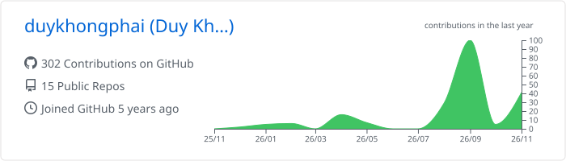
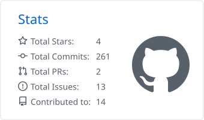
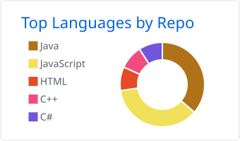
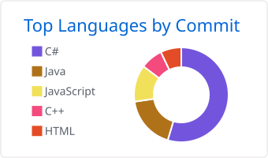
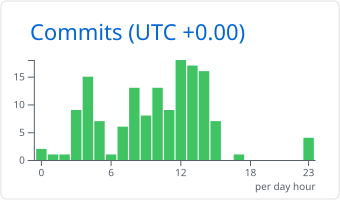
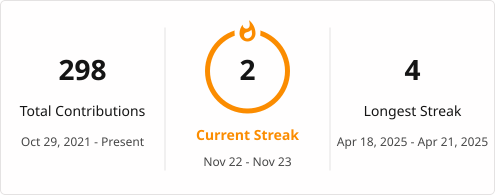

<div align="center">


<a href="https://github.com/duykhongphai">
  
</a>

<p>
  <a href="https://www.youtube.com/@DuyKhongPhai"></a>
  <a href="https://github.com/duykhongphai"></a>
  
</p>

</div>

## About me

```java
public class DuyNguyen {
    String role      = "Software Developer";
    String[] loves   = { "game servers", "reverse engineering", "emulators", "deep learning OCR" };
    String[] builds  = { "a JVM in C for iOS", "a JVM in TypeScript for the web", "anti-bot captchas" };
    String  motto    = "Clean, fast, low-level code.";
}
```

- Game server development with high-concurrency tuning
- Retro mobile games: **J2ME emulators** for iPhone and the web, J2ME → LibGDX conversions
- Reverse engineering and binary analysis with IDA Pro
- Deep learning OCR and automation tools

## Tech stack

<div align="center">

<br/>


</div>

## Spotlight

<table>
<tr>
<td width="50%" valign="top">

### [J2ME4iOS](https://github.com/duykhongphai/J2ME4iOS)
**Play J2ME games on iPhone.** A Java VM written from scratch in portable C (no JIT), with the
CLDC/MIDP library reimplemented in Java.

- **3D:** M3G (JSR-184) + Mascot Capsule v3, software rasterizer
- Built-in General MIDI synth, tone sequences, Nokia ringtones
- Several games at once, 5 save slots, SOCKS5 / HTTP proxy per slot
- MFi / Xbox / PlayStation controllers, sliding on-screen keypad
- Nokia, Samsung, Siemens, Motorola, LG APIs

<a href="https://github.com/duykhongphai/J2ME4iOS/releases/latest"></a>
<a href="https://github.com/duykhongphai/J2ME4iOS"></a>

</td>
<td width="50%" valign="top">

### [J2ME4W](https://github.com/duykhongphai/J2ME4W)
**Play J2ME games in the browser.** A JVM written in TypeScript plus a MIDP implementation;
nothing is uploaded, the JAR stays in your browser.

- Game library with icons, per-game settings
- Several games in tabs, grid view, synced input
- Keypad editor, keyboard and gamepad remapping
- General MIDI synth, WebAudio sound
- Network bridge for online games

<a href="https://duykhongphai.github.io/J2ME4W/"></a>
<a href="https://github.com/duykhongphai/J2ME4W"></a>

</td>
</tr>
</table>

## More projects

<table>
<tr>
<td width="50%" valign="top">

### [DataNro](https://github.com/duykhongphai/DataNro)
Items, monsters, NPCs, skills and maps of **Ngọc Rồng Online**, pulled straight from the game
servers and updated automatically every day. Static JSON + sprite API and a lookup site.

<a href="https://duykhongphai.github.io/DataNro/"></a>


</td>
<td width="50%" valign="top">

### [LoudLift](https://github.com/duykhongphai/LoudLift)
Make any video louder and evenly loud, without re-encoding the picture: the video stream is copied
bit for bit, only the audio is processed. Self-hosted web tool on FFmpeg, GPU + CPU.


</td>
</tr>
<tr>
<td width="50%" valign="top">

### [CaptchaGenerator](https://github.com/duykhongphai/CaptchaGenerator)
Randomized captcha images (backgrounds, glyphs, effects) that keep bots and auto tools out of
Ngọc Rồng Online servers, tuned for speed.


</td>
<td width="50%" valign="top">

### [NinjaSchoolCaptcha](https://github.com/duykhongphai/NinjaSchoolCaptcha)
Lightweight captcha for Ninja School game servers: players answer visual arrow challenges,
bots do not.


</td>
</tr>
</table>

## GitHub stats

<div align="center">

<picture>
  <source media="(prefers-color-scheme: dark)" srcset="https://raw.githubusercontent.com/duykhongphai/duykhongphai/main/profile-summary-card-output/github_dark/0-profile-details.svg">
  
</picture>

<picture>
  <source media="(prefers-color-scheme: dark)" srcset="https://raw.githubusercontent.com/duykhongphai/duykhongphai/main/profile-summary-card-output/github_dark/3-stats.svg">
  
</picture>
<picture>
  <source media="(prefers-color-scheme: dark)" srcset="https://raw.githubusercontent.com/duykhongphai/duykhongphai/main/profile-summary-card-output/github_dark/1-repos-per-language.svg">
  
</picture>
<picture>
  <source media="(prefers-color-scheme: dark)" srcset="https://raw.githubusercontent.com/duykhongphai/duykhongphai/main/profile-summary-card-output/github_dark/2-most-commit-language.svg">
  
</picture>
<picture>
  <source media="(prefers-color-scheme: dark)" srcset="https://raw.githubusercontent.com/duykhongphai/duykhongphai/main/profile-summary-card-output/github_dark/4-productive-time.svg">
  
</picture>

<a href="https://git.io/streak-stats">
<picture>
  <source media="(prefers-color-scheme: dark)" srcset="https://raw.githubusercontent.com/duykhongphai/duykhongphai/main/profile/streak-dark.svg">
  
</picture>
</a>

<picture>
  <source media="(prefers-color-scheme: dark)" srcset="https://github-readme-activity-graph.vercel.app/graph?username=duykhongphai&hide_border=true&area=true&custom_title=Contribution%20Graph&bg_color=0d1117&color=E100FF&title_color=E100FF&line=E100FF&point=00D4FF&area_color=7F00FF">
  
</picture>

<picture>
  <source media="(prefers-color-scheme: dark)" srcset="https://raw.githubusercontent.com/duykhongphai/duykhongphai/output/github-contribution-grid-snake-dark.svg">
  <source media="(prefers-color-scheme: light)" srcset="https://raw.githubusercontent.com/duykhongphai/duykhongphai/output/github-contribution-grid-snake.svg">
  
</picture>

</div>

<div align="center">


</div>
